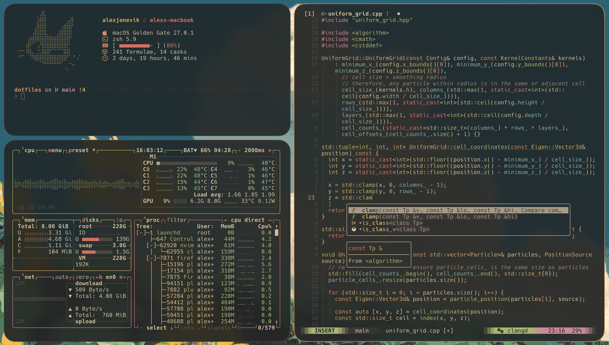

```text
 ▄▄█  ▄▄  ▄█▄   ▄▀▀ ▀ █  ▄▄   ▄▄▄ 
█  █ █  █  █   ▀█▀  █ █ █▀▀▀ ▀▀▄▄ 
 ▀▀▀  ▀▀    ▀▀  ▀   ▀ ▀  ▀▀▀ ▀▀▀
                                          
 about ░ my custom macos/unix config
author ▒ alex janevik
```

<div align="center">

  [overview](#overview) • [install](#install)
</div>

## overview

my dotfiles, managed with [gnu stow](https://github.com/aspiers/stow). works on macos and linux. ghostty is my terminal emulator and nvim is my editor of choice. out of the box there isn't a colour scheme until it's initialised using [colourme](https://github.com/lukamanitta/colourme). i'm currently using a custom port of [gruvbox material dark](https://github.com/sainnhe/gruvbox-material).

## install

first install stow on your machine, then:

```sh
# clone
git clone https://github.com/alexjanevik/dotfiles.git ~/dotfiles
cd ~/dotfiles

# link common configs
stow -t ~ common

# macos specific (yabai, skhd & jankyborders for window management)
stow -t ~ macos
```

to update or uninstall:

```sh
# update
git pull && stow -R -t ~ common macos

# uninstall
stow -D -t ~ common macos
```

>[!WARNING]
> stow refuses to link over existing files. make sure you back them up or delete them first.
